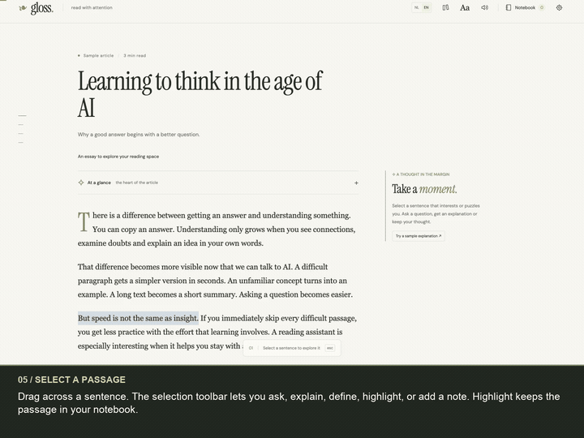
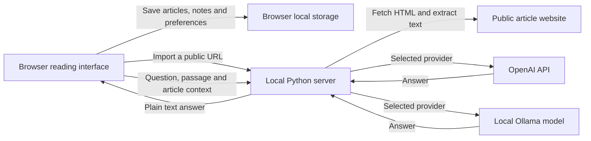

# Gloss Reader

A quiet, standalone reading app. Open an article, explore a passage in the margin, and keep the thoughts you want to remember. The app has English and Dutch interfaces; this documentation and the walkthrough are entirely in English.

## Watch the walkthrough

[](https://robbertvanempel.github.io/gloss-reader/)

**[Watch the full English walkthrough](https://robbertvanempel.github.io/gloss-reader/)** · [Download the MP4](https://github.com/robbertvanempel/gloss-reader/raw/refs/heads/main/docs/gloss-reader-walkthrough.mp4) · [English captions](docs/gloss-reader-walkthrough.vtt) · [Video transcript and chapters](docs/walkthrough.md)

The two-minute video shows the actual app with English narration and visible captions: opening text, reading a summary, highlighting, viewing a sample explanation, saving notes, exporting, changing appearance, using focus mode, and connecting a model. It was recorded in an empty workspace using generic example content. No personal articles, notes, credentials, desktop windows, or account details appear in it.

## Start the app

You need **Python 3.10 or newer**. No Python packages, Node.js installation, or JavaScript build step are required to run the app.

```sh
git clone https://github.com/robbertvanempel/gloss-reader.git
cd gloss-reader
python3 server.py --port 8767
```

Open **[http://localhost:8767](http://localhost:8767)**, then choose **EN** in the top bar. Your language choice is saved in this browser.

On macOS, you can also double-click `Start Gloss.command`. On Windows, use `python server.py --port 8767` if your Python command is named `python`. Stop the server with Ctrl+C in its terminal. The server listens on `127.0.0.1`, so this is a local app rather than a hosted service.

## Use the app

### 1. Open something to read

Click the logo or **Library** button to reach the home screen. You have three options:

- Paste a public article URL and choose **Open article**. Gloss extracts the page's text into a reading view.
- Choose **Or paste your own text**, enter a title and text, and choose **Start reading**. Blank lines create paragraphs; a paragraph beginning with `## ` becomes a section heading.
- Choose **Try the sample** to explore the original example essay without an AI account.

Imported articles and your own notes keep their original wording when you switch languages.

### 2. Explore a passage

Drag across a sentence or paragraph to open the selection toolbar.

| Action | What happens |
| --- | --- |
| Ask | Opens a question box beside the selected passage. |
| Explain | Requests an explanation in simple terms. |
| Define | Requests a definition of the key concept. |
| Highlight | Saves the passage in your notebook and marks it in the article. |
| Add note | Saves the passage together with your own thought. |

An explanation appears in the margin while the article stays visible. Choose **Save** to keep the answer, or **Your note** to write your own response. With a connected model, you can ask follow-up questions such as “Give a concrete example” or “What assumption is being made?”

**At a glance** opens the article's summary. The sample essay includes its own summary. Summaries of imported or pasted articles require a model connection.

### 3. Keep and revisit notes

Open **Notebook** in the top bar. It contains your highlights, notes, and saved explanations across articles. The **All**, **Highlights**, and **Notes** tabs filter the list. Click a saved passage to return to its article. **Export as Markdown** downloads a text file containing the quotes, notes, saved explanations, and dates.

The notebook is saved in this browser. Export a separate copy when you want to retain your notes outside browser storage.

### 4. Adjust your reading space

Choose **Aa** to open **Appearance**. Change the paper color, typeface, text size, line spacing, or highlight color. **F** toggles focus mode; **Esc** returns to the normal view. The speaker button uses your browser's text-to-speech feature. Speech follows the article's language when available.

## Connect AI

The sample essay has clearly labelled, **prewritten sample explanations**. These show the interface without pretending a model is connected. Your own questions and summaries need a working connection.

Open **AI settings** and choose one of these providers:

| Provider | Setup | Where the request goes |
| --- | --- | --- |
| OpenAI | Enter your API key and model name. The default is `gpt-4.1-mini`. | The local server calls the OpenAI Chat Completions API. |
| Ollama | Start Ollama on this computer, download a model, and enter that model's name. The default name is `llama3.2`. | The local server calls Ollama at `http://127.0.0.1:11434`. |

Choose **Use this connection** after entering the settings. English mode requests English answers unless your question explicitly asks for another language.

An API key entered in the app stays in the current tab's memory. It is sent to the local server when needed, but is not saved in browser storage. Reloading the tab clears that key.

Advanced setup can use server environment variables:

| Variable | Purpose |
| --- | --- |
| `OPENAI_API_KEY` | Supply a key on the local server instead of in the tab. |
| `OPENAI_MODEL` | Change the server's default OpenAI model. |
| `OPENAI_BASE_URL` | Change the OpenAI-compatible API base URL. |
| `OLLAMA_URL` | Change the Ollama server URL. |
| `OLLAMA_MODEL` | Supply the Ollama default when a request omits a model. |

Do not put credentials in source files. Provider references: [OpenAI Chat Completions](https://developers.openai.com/api/reference/resources/chat), [Ollama chat API](https://docs.ollama.com/api/chat).

## How it works



The frontend uses HTML, CSS, and plain JavaScript. `server.py` serves the app and provides three routes: `/api/status` for connection status, `/api/import` for article extraction, and `/api/ask` for model requests. Import uses Python's HTML parser without executing page scripts. Article text is passed to the model as untrusted source material, separately from the assistant's instructions.

Each AI request includes the selected passage, up to 65,000 characters of article text, and recent conversation messages. Very long articles may therefore have incomplete context. The selected provider receives this material when you ask a question or generate a summary. OpenAI requests set `store: false` in the API request; this is not a broader claim about provider retention policies.

## Data and limits

- Your articles, notes, and preferences stay in this browser's local storage. They are not synchronized across browsers or computers. Clearing browser data can remove them; Markdown export gives you a separate copy.
- The repository contains app code, original generic sample content, and the demonstration media. It contains no personal reading history, notes, credentials, or local configuration.
- Fonts load from Google Fonts, with local fallbacks when offline.
- Import supports public HTML pages. Login pages, paywalls, bot protection, and sites that need JavaScript may require the paste option. Some imported pages can include footnotes or navigation text.
- There are no user accounts, shared notebooks, or production hosting in the app.

For common problems, see the [step-by-step guide and troubleshooting](docs/user-guide.md).

## Project files

| File | Role |
| --- | --- |
| `index.html`, `style.css` | Reading interface and layout. |
| `app.js` | Article rendering, selection, conversations, notebook, and preferences. |
| `i18n.js` | English interface copy and English sample essay. |
| `server.py` | Local server, public URL import, and model requests. |
| `test_server.py` | Extraction, language, URL validation, and provider contract tests. |
| `docs/` | English guide, walkthrough video, captions, transcript, and preview. |

## Tests

```sh
python3 -m unittest test_server.py
node --check app.js
node --check i18n.js
```

Node.js is only needed for the optional JavaScript syntax checks. Server tests use test doubles for model responses; they do not spend API credits. Live answers require a working provider connection.

Gloss Reader is an independent implementation inspired by a reading-interface demonstration. Its sample essay and sample explanations are original product content.
